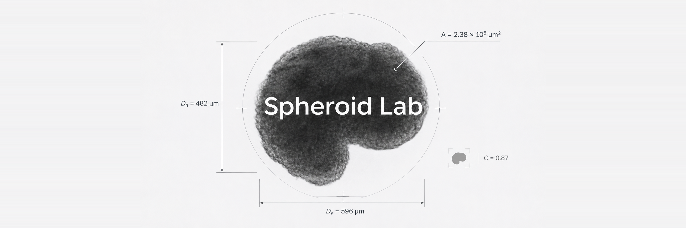

# Spheroid Lab

Aplicação local para medir **forma e área projetada de esferoides em micrografias 2D de campo claro**. Importe imagens, revise os contornos no navegador e obtenha os resultados em CSV. Os dados ficam na máquina que executa a aplicação.

Autor principal: [Gabriel Santos (@CodesOfGabriel)](https://github.com/CodesOfGabriel).

[Instalação](#instalação) · [Revisar e exportar](#revisar-e-exportar)

## Protocolo e fórmulas

O Spheroid Lab mede projeções 2D. Áreas são expressas em **px²**, comprimentos em **px** e índices de forma são adimensionais.

### Segmentação

Para a imagem em cinza $I$ e o filtro gaussiano $G_\sigma$, o fundo $B$, a imagem corrigida $F$ e o mapa de desvio $D$ são:

```math
B=G_{60}*I,\qquad F=\frac{I}{B+10^{-6}},\qquad D=G_3*|F-1|.
```

A máscara inicial é $`D\gt T_{\mathrm{Otsu}}`$. O algoritmo preenche vazios internos, remove componentes com menos de 15.000 px², aplica abertura com disco de raio 8 px e preenche vazios novamente. Registra a contagem de componentes e seleciona o maior componente conexo, $M_0$. A máscara final é:

```math
M=\mathrm{preencher}\left(\left[G_6*M_0\gt 0{,}5\right]\right).
```

O traçado manual entra no pós-processamento com preenchimento, seleção do maior componente e a mesma suavização. No revisor, o mapa é convertido para 8 bits a partir do percentil 99,5. O controle usa $`\sigma_{\mathrm{fundo}}\in\{30,45,60,90,120,180\}`$ e deslocamento $\delta\in[-60,60]$:

```math
D_8=\left\lfloor255\,\mathrm{clip}\left(\frac{D}{\max(Q_{99{,}5}(D),10^{-9})},0,1\right)\right\rfloor,\qquad T_8=\mathrm{clip}\!\left(T_{\mathrm{Otsu}}(D_8)+\delta,1,254\right).
```

A quantização pode mudar o contorno mesmo com $\delta=0$. A medição em lote usa o mapa em ponto flutuante. Exposição e contraste da interface atuam na visualização. [Parâmetros](src/esferoides/config.py) · [Segmentação](src/esferoides/segmentacao.py).

### Medidas da máscara

$`M(x,y)\in\{0,1\}`$ indica os pixels da região medida, $P$ é o perímetro e $A_{\mathrm{convexa}}$ é a área do fecho convexo rasterizado. Os comprimentos $L$ e $l$ vêm da elipse de segundos momentos. Para os autovalores normalizados $\lambda_{\max}$ e $\lambda_{\min}$, valem $L=4\sqrt{\lambda_{\max}}$ e $l=4\sqrt{\lambda_{\min}}$.

| Métrica e coluna | Fórmula ou estimador | Interpretação |
|---|---|---|
| Área projetada, `area_px` | $A=\sum_{x,y}M(x,y)$ | Número de pixels da região, em px². |
| Perímetro, `perimetro_px` | `regionprops.perimeter` | Estimativa em px com conectividade 4, baseada nos centros dos pixels de borda. |
| Circularidade, `circularidade` | $\displaystyle C=\frac{4\pi A}{P^2}$ | Índice que combina área e perímetro. |
| Roundness, `roundness` | $\displaystyle R=\frac{4A}{\pi L^2}$ | Arredondamento em função do eixo maior. |
| Aspect ratio, `aspect_ratio` | $\displaystyle AR=\frac{L}{\max(l,1\ \mathrm{px})}$ | Alongamento da elipse de momentos. O código usa piso de 1 px no denominador de $L/l$. |
| Solidity geométrica, `solidity` | $\displaystyle S=\frac{A}{A_{\mathrm{convexa}}}$ | Fração ocupada do fecho convexo. |
| Diâmetro equivalente, `diam_equiv_px` | $\displaystyle D_{\mathrm{eq}}=2\sqrt{\frac{A}{\pi}}$ | Diâmetro, em px, do círculo com a mesma área projetada. |
| Feret máximo, `feret_max_px` | $\displaystyle F_{\max}=\max_{p,q\in\partial H}\left\Vert p-q\right\Vert_{2}$ | Maior distância em px entre pontos do contorno do fecho convexo $H$, estimado por `regionprops.feret_diameter_max`. |
| Eixo menor, `eixo_menor_px` | $l$ | Comprimento em px. O rótulo histórico `feret_min_px` é lido como eixo menor. MinFeret exige um estimador de calibre mínimo. |
| Circularidade sem suavização, `circularidade_sem_suavizar` | $\displaystyle C_0=\frac{4\pi A_0}{P_0^2}$ | A fórmula da circularidade no maior componente antes da suavização. |

`n_objetos` conta os componentes da máscara que chega à etapa de seleção. `toca_borda` vale 1 quando a caixa da região medida alcança um limite da imagem e 0 nos demais casos. [Código das medidas](src/esferoides/medidas.py) · [Documentação de regionprops](https://scikit-image.org/docs/stable/api/skimage.measure.html#skimage.measure.regionprops).

### Séries temporais e resumos

Para o mesmo esferoide na mesma placa, com referência válida em D0, a coluna `area_norm_D0` é:

```math
A_{\mathrm{rel}}(t)=\frac{A_t}{A_{D0}}.
```

A aba **Resultados** usa apenas correções manuais e exige um D0 manual para a normalização. A triagem calcula variação relativa entre tempos disponíveis a partir de D1 e relata o percentual quando sinaliza um aumento:

```math
\Delta A(t_1,t_0)\,[\%]=100\,\frac{A_{t_{1}}-A_{t_{0}}}{A_{t_{0}}}.
```

O denominador deve ser positivo. Para tempos consecutivos, use $t_1=t$ e $t_0=t-1$. O CSV principal exporta as áreas e a área normalizada. Os gráficos mostram mediana e o intervalo de $Q_{25}$ a $Q_{75}$. O relatório de triagem também exporta médias e desvios padrão amostrais por grupo e dia. Separe as unidades biológicas independentes e mantenha o pareamento por esferoide em análises inferenciais.

### Vazios e comparação entre programas

No **revisor padrão**, área e perímetro vêm da mesma máscara final, após o preenchimento dos vazios. Na **Validação Cega**, a máscara segmentada humana pode subtrair regiões internas. Nesse caso, a área conta os pixels restantes e o perímetro externo vem da silhueta preenchida. A comparação por silhueta preenche as duas máscaras. [Fórmulas de concordância](docs/validacao-cega.md#métricas-de-concordância).

A comparação numérica entre programas depende da máscara, do tratamento de vazios, do perímetro e dos eixos, dos componentes incluídos e da calibração. O diâmetro equivalente descreve a projeção 2D. Uma estimativa tridimensional exige dados ou hipóteses adicionais.

### Fórmulas de referência sem cálculo no aplicativo

**Mean Gray Value (MGV)** é a intensidade média dos $N$ pixels de uma região de interesse:

```math
MGV=\frac{1}{N}\sum_{i=1}^{N} I_i.
```

**Índice óptico normalizado (MGVi)** usa os extremos observados dentro de cada experimento biológico independente:

```math
{MGVi}_{i}=\frac{MGV_{\max}-MGV_i}{MGV_{\max}-MGV_{\min}}.
```

O índice varia de 0 a 1 quando o intervalo é positivo. Valores maiores correspondem a micrografias relativamente mais escuras sob condições de aquisição padronizadas. Um intervalo zero deixa o índice indefinido.

**Área calibrada** usa dimensões físicas verificadas para cada pixel, $s_x$ e $s_y$, em µm:

```math
A_{\mu\mathrm{m}^2}=N_{\mathrm{pixels}}\,s_x\,s_y.
```

**Liberação de LDH** usa as atividades do ensaio bioquímico em unidades comparáveis:

```math
LDH_{\mathrm{liberada}}\,[\%]=100\,\frac{LDH_{\mathrm{extra}}}{LDH_{\mathrm{extra}}+LDH_{\mathrm{intra}}}.
```

Essas quatro fórmulas são referências metodológicas externas ao CSV do aplicativo. [Artigo de referência, Molecular Biology Reports](https://link.springer.com/article/10.1007/s11033-026-12715-9).

## Instalação

Instale Python 3.11 ou mais recente. Clone este repositório pelo botão **Code** do GitHub e abra um terminal na pasta clonada.

**Windows, PowerShell**

```powershell
python -m venv .venv
.\.venv\Scripts\python.exe -m pip install .
.\.venv\Scripts\python.exe -m esferoides revisar --sem-aquecer
```

**Linux e macOS**

```bash
python3 -m venv .venv
./.venv/bin/python -m pip install .
./.venv/bin/python -m esferoides revisar --sem-aquecer
```

Abra [http://127.0.0.1:7860/](http://127.0.0.1:7860/). Clique em **+ Novo projeto**, dê um nome e selecione a pasta raiz das imagens. Ao concluir a importação, o aplicativo abre o revisor. Nas próximas sessões, clique no card do projeto. Mantenha o terminal aberto e use **Ctrl+C** para encerrar.

Com o ambiente virtual ativado, `spheroid-lab revisar` também funciona. No Windows, `.\iniciar-spheroid-lab.cmd` usa o código do checkout se o Python disponível no terminal já tiver as dependências.

## Preparar as imagens

Use PNGs com um esferoide principal por imagem. Os nomes abaixo são ilustrativos.

```text
meu-experimento/
├── n1/
│   ├── d0/
│   │   ├── D0 A1.png
│   │   └── D0 B1.png
│   └── d1/
│       ├── D1 A1.png
│       └── D1 B1.png
└── n2/
    └── d0/
        └── D0 A1.png
```

- `n1`, `n2` etc. identificam conjuntos ou placas. Registre quais placas pertencem à mesma execução biológica.
- `d0`, `d1` etc. identificam os tempos. O dia no nome do PNG precisa coincidir com o da pasta. Projetos de tempo único também são aceitos.
- `A` e `B` são códigos de grupo compostos por letras. Mantenha o mesmo grupo e número do esferoide nos diferentes tempos da série. Use `.png` em minúsculas.
- Comece com algumas fotos representativas. O filtro automático remove objetos menores que **15.000 px²**. Escala de aquisição, contraste e artefatos influenciam a segmentação. Confira visualmente as máscaras antes de analisar os resultados. [Protocolo e parâmetros](#segmentação).

Para importar um projeto já processado, inclua `_analise` com `resultados/medidas_esferoides.csv` e os arquivos de revisão. Para trabalhar diretamente sobre uma pasta existente, use `revisar --dados CAMINHO`. A pasta vinculada precisa ter o CSV automático e permitir gravação em `_analise`. Se só tiver imagens, use **Novo projeto** ou execute `medir --dados CAMINHO`.

## Revisar e exportar

1. Abra **Conferência** e compare a foto com a máscara. Clique em **Contorno OK** para registrar a aceitação ou edite com pincel, laço ou pincel mágico e clique em **Salvar correção**. Use **Excluir imagem** quando a qualidade comprometer a medição.
2. No **Ajuste rápido**, exposição e contraste mudam a visualização. Limiar e escala do fundo geram uma proposta de contorno. Os parâmetros usados são registrados ao salvar.
3. Abra **Resultados** para resumir as correções manuais e **Galeria** para navegar pelas imagens. Os modos C/T e de quatro grupos pressupõem os códigos `LC`, `LT`, `HC` e `HT`. Os CSVs preservam os demais códigos.
4. Abra `_analise/resultados/`. `medidas_esferoides.csv` contém as medidas automáticas. `medidas_final.csv` é atualizado ao salvar ou reverter uma decisão. Use `status` e `revisado_em` para identificar as decisões.

| Estado | Significado |
|---|---|
| `ok` | Medida automática. Quando `revisado_em` está preenchido, o contorno foi aceito explicitamente. |
| `manual` | Contorno corrigido manualmente. |
| `excluido` | Imagem excluída por decisão registrada, com medidas vazias. |
| `falha` | Medição automática sem contorno mensurável. |

Projetos importados ficam em `dados/projetos/<id>/arquivos/`. Projetos vinculados gravam na pasta original. Use `--projetos CAMINHO` para escolher outro catálogo. Para backup, encerre a aplicação e copie o catálogo, as pastas vinculadas e as sessões de validação que quiser preservar.

### Linha de comando

Use `python -m esferoides` seguido de um subcomando. `ESFEROIDES_DADOS` pode definir a pasta usada em lugar de `--dados`.

| Subcomando | Resultado |
|---|---|
| `revisar` | Abre o catálogo. `--porta` muda a porta e `--dados` vincula um projeto existente. |
| `medir --dados CAMINHO` | Gera o CSV automático, imagens de conferência e folhas de contato. |
| `verificar --dados CAMINHO` | Gera triagem e resumo descritivo. As faixas de diâmetro e evolução temporal são heurísticas de um protocolo de referência. |
| `graficos --dados CAMINHO` | Gera figuras para o desenho D0–D3 e LC/LT/HC/HT. `--conferidas` usa apenas correções manuais. Para outros desenhos, use o painel agregado ou analise o CSV. |
| `reconstruir --dados CAMINHO` | Reconstitui as decisões usando o diário e as máscaras. Faça backup antes de executar. |
| `validacao --help` | Mostra as opções do módulo opcional de Validação Cega. |

O servidor usa localhost por padrão. `--rede` ativa o acesso pela rede local e protege o revisor por token. Guarde o link completo como credencial de escrita. A Validação Cega usa autenticação própria.

## Métodos e desenvolvimento

- [Protocolo, fórmulas e limites](#protocolo-e-fórmulas)
- [Validação Cega e métricas de concordância](docs/validacao-cega.md)
- [Decisões de implementação](docs/decisoes.md)
- [Licença MIT](LICENSE)

Para rodar os testes com dados sintéticos, instale com `python -m pip install -e ".[dev]"` e execute `python -m pytest`. Para a suíte opcional de canvas, use `node --test tests/test_validacao_canvas.mjs`.

## English quick start

Clone this repository and install it with Python 3.11+ using `python -m pip install .` in a virtual environment. Run `python -m esferoides revisar --sem-aquecer` and open [localhost:7860](http://127.0.0.1:7860/). Click **Novo projeto** and select a root folder with files such as `n1/d0/D0 A1.png`. Inspect and correct the masks in **Conferência**. Measurements are saved under `_analise/resultados/`. The [methods and formulas](#protocolo-e-fórmulas) report 2D measurements in pixel units.
